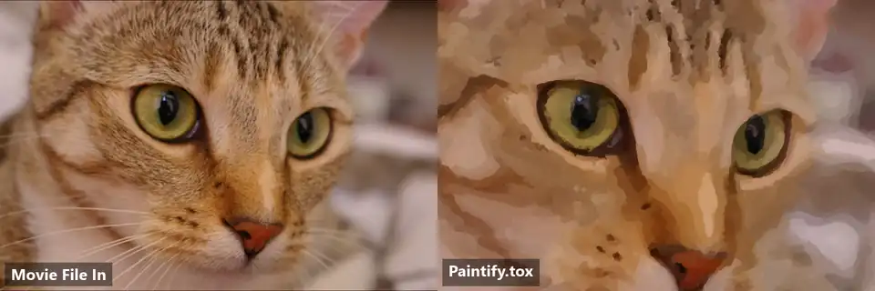
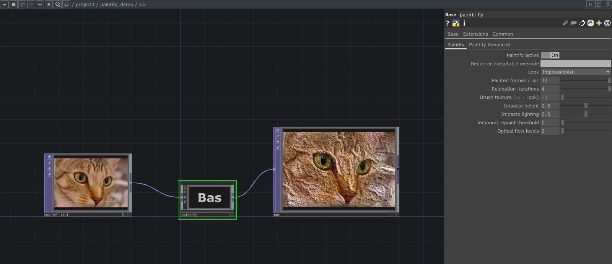
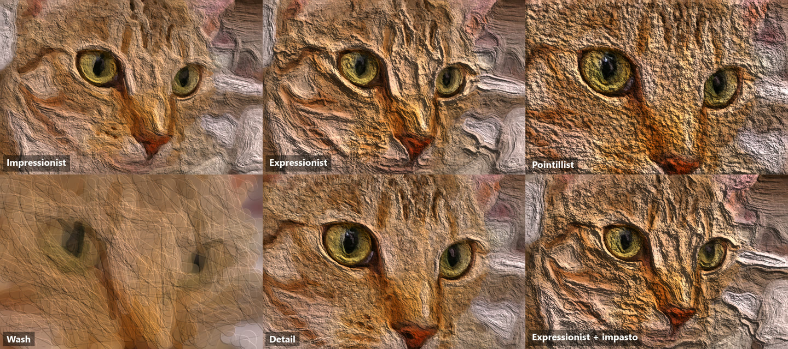
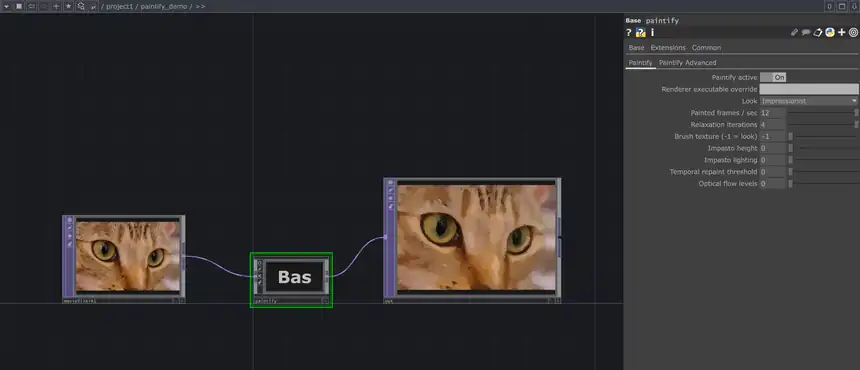

# Paintify for TouchDesigner

Turn any TouchDesigner TOP into a live, GPU-painted oil painting.

  

## Install (one file)

1. **[Download Paintify.tox](https://github.com/BrownBearr/paintify-touchdesigner/raw/main/Paintify.tox)**
2. Drag it into a TouchDesigner Network Editor.
3. Connect any TOP (Movie File In, Video Device In, ...) to its input and view its output.

  

That is all. The TOX carries its own renderer, DLLs and shaders and unpacks
them to `%LOCALAPPDATA%\Paintify` the first time it loads. There is nothing to
build, clone or install, and no other files from this repository are needed.

**Requirements:** Windows 10/11, TouchDesigner (any recent build), and a GPU
with OpenGL 4.6. TouchDesigner's own installer provides the VC++ runtime the
renderer uses. TouchDesigner Non-Commercial limits images to 1280x1280.
The TOX is Windows-only; see the [macOS port notes](docs/macos-touchdesigner-feasibility.md).

## Controls

**Look** picks Impressionist, Expressionist, Pointillist, Wash or Detail. The
main page also has painted FPS, relaxation, brush texture, impasto, temporal
repaint and optical flow. **Brush texture = -1** uses the look's own value.

The **Paintify Advanced** page exposes radii, threshold, curvature, opacity,
stroke lengths, underpaint, tensor smoothing, edge tangent flow, bristle
density, dry brush, lighting angle, jitters and relaxation tuning. Numeric
advanced controls default to `-1`, which keeps the look's preset. Look, FPS
and painting controls apply live without restarting the renderer.

  

   
  Changing <b>Look</b> and impasto while the video plays. The renderer keeps running. <a href="docs/media/network.mp4"><b>▶ Full-resolution clip</b></a>

## Troubleshooting

- **Blank output:** check the Textport (Dialogs > Textport). The component
  prints its log path on start; the log lives in
  `%LOCALAPPDATA%\Paintify\<bundle-id>\paintify-live.log`.
- Verify the input TOP displays an image on its own before connecting it.
- Multiple Paintify components can coexist in one project.
- Toggle **Paintify active** off and on to restart the renderer.

## For developers

The rest of the repository is only needed to modify or rebuild Paintify.

- [Building the TOX](docs/building-the-tox.md)
- [Standalone renderer (CLI and GUI), pipeline and measurements](docs/standalone-renderer.md)
- [Architecture](docs/architecture.md)

## License

Paintify is MIT licensed; see [LICENSE](LICENSE). `Paintify.tox` bundles Spout2,
Dear ImGui, GLFW, GLM, glad and stb under their own licenses; see
[THIRD_PARTY_NOTICES.md](THIRD_PARTY_NOTICES.md).

---

Demo footage: Chelsea the cat (Stefan van der Walt), CC0.
